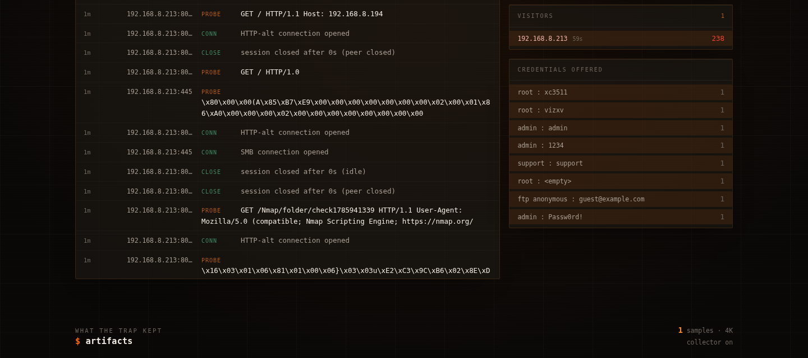
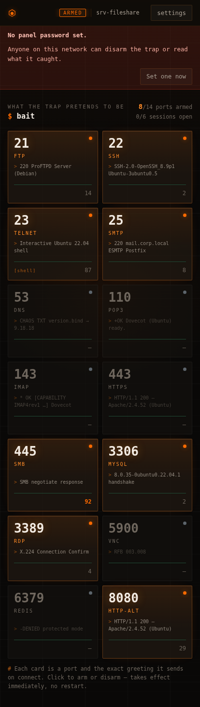

# ESP32 Honeypot

A multi-port honeypot for ESP32. It impersonates a small Linux file server,
records everything an attacker types, retrieves the malware they try to install,
and shows all of it in a control panel served from the device itself.

Every screenshot below is this firmware running on an **ESP32-S3-N16R8**
(16 MB flash, 8 MB octal PSRAM) with live capture data.


---

## Contents

- [What it does](#what-it-does)
- [Hardware you need](#hardware-you-need)
- [Install the toolchain](#install-the-toolchain)
- [Flash it](#flash-it)
- [First-time setup](#first-time-setup)
- [Default credentials](#default-credentials)
- [Using the panel](#using-the-panel)
- [Artifact collector](#artifact-collector)
- [Alerts](#alerts)
- [LAN-only mode](#lan-only-mode)
- [Why only 8 ports](#why-only-8-ports)
- [Verified against nmap](#verified-against-nmap)
- [HTTP API](#http-api)
- [Troubleshooting](#troubleshooting)
- [How it is built](#how-it-is-built)
- [Exposing it to the internet](#exposing-it-to-the-internet)

---

## What it does

- **Fourteen emulated services** — FTP, SSH, Telnet, SMTP, DNS, POP3, IMAP,
  HTTPS, SMB, MySQL, RDP, VNC, Redis, HTTP-alt. Eight can be armed at once
  ([why](#why-only-8-ports)). FTP, SMTP, POP3, IMAP and Redis hold a real
  conversation and capture credentials; the rest answer with protocol-accurate
  binary greetings.
- **An interactive fake shell** on telnet with a data-driven filesystem, real
  path resolution, and bait worth stealing: `/etc/shadow`, an SSH private key, a
  backup script with a hardcoded database password. Reading any of them raises an
  alert.
- **Botnet awareness.** Mirai-family loaders are the overwhelming majority of
  real telnet traffic. Their probe sequence (`enable`, `system`, `shell`, `sh`,
  `/bin/busybox <SIG>`) is answered byte-accurately — `<SIG>: applet not found`,
  exactly as real busybox replies — so the loader proceeds to the payload stage
  instead of hanging up. That stage is the part worth capturing.
- **Malware collection.** `wget`/`curl`/`tftp` URLs are fetched, hashed with
  SHA-256, identified by ELF architecture and stored for download.
- **Alerting** to Discord, Telegram, a JSON endpoint, or syslog.
- **A control panel** that runs permanently, on your network and on its own
  fallback access point — and that refuses connections from outside your
  network by design, so it stays safe when the bait ports are internet-facing.
- **LAN-only mode** for running it as an internal canary instead, where every
  hit is by definition something already inside your network.

## Hardware you need

| | |
|---|---|
| Board | Any ESP32. Developed and tested on **ESP32-S3-N16R8**. Environments also provided for classic ESP32 (`esp32dev`) and M5Stack AtomS3 (`atoms3`). |
| Cable | A USB **data** cable — many cheap cables are power-only and the board will never appear as a serial port. |
| Network | 2.4 GHz Wi-Fi. ESP32 does not do 5 GHz. |

ESP32-C6 (NanoC6) and C5 need Arduino core 3.x — use the
[pioarduino](https://github.com/pioarduino/platform-espressif32) platform fork
instead of `espressif32 @ ^6.6.0`.

## Install the toolchain

```bash
pip install platformio          # or: pipx install platformio
```

On Linux, add yourself to the group that owns serial ports, then log out and back
in (otherwise you will need `sudo` to flash):

```bash
sudo usermod -aG dialout $USER      # Debian/Ubuntu/Kali
sudo usermod -aG uucp $USER         # Arch
```

No libraries to install by hand — `ArduinoJson` is fetched automatically on the
first build and everything else ships with the Arduino ESP32 core.

## Flash it

```bash
git clone http://192.168.178.18:3030/cybercoon/honeypot.git
cd honeypot

pio run -e esp32s3 -t upload        # build + flash
pio device monitor                  # serial console at 115200 baud
```

Pick the environment that matches your board:

| Board | Command |
|---|---|
| ESP32-S3-N16R8 | `pio run -e esp32s3 -t upload` |
| Classic ESP32 (4 MB) | `pio run -e esp32dev -t upload` |
| M5Stack AtomS3 | `pio run -e atoms3 -t upload` |

If the port is not auto-detected, pass it:

```bash
pio run -e esp32s3 -t upload --upload-port /dev/ttyACM0
```

Find the port with `ls /dev/ttyACM* /dev/ttyUSB*` (Linux),
`ls /dev/cu.*` (macOS), or Device Manager (Windows). Boards that do not reset
automatically need the **BOOT** button held while you plug them in.

There is **no filesystem upload step**. The web UI is compiled into the firmware:
`tools/gen_ui.py` gzips `ui/index.html` into `src/ui_index.h` as a pre-build
step, so 52 KB of HTML becomes 15 KB of flash and can never drift out of sync
with the binary. Edit `ui/index.html` and rebuild — the header regenerates
itself.

> **ESP32-S3 N16R8 owners:** `board_build.arduino.memory_type = qio_opi` is
> already set for `env:esp32s3` and is required. These modules carry *octal*
> PSRAM; with the quad default the chip reports "PSRAM not found" and the event
> ring silently drops from 2048 entries in PSRAM to 128 in heap.

## Status LED

If the board has a WS2812/NeoPixel wired up, the firmware drives it as a
one-glance health light:

| State | Meaning |
|---|---|
| Breathing yellow | Not on the Wi-Fi network — unconfigured, or the link to the AP is down. |
| Breathing green | On Wi-Fi, no alerts. The trap is armed and quiet. |
| Blinking red | At least one `SEV_ALERT` event — credential theft, dropper URL, botnet signature. |

The pixel pin is set per environment with `-DHP_STATUS_LED_PIN=<gpio>`:

| Board | Pin |
|---|---|
| ESP32-S3-N16R8 (`esp32s3`) | GPIO 48 |
| M5Stack AtomS3 (`atoms3`) | GPIO 35 (built-in RGB LED) |
| Classic ESP32 (`esp32dev`) | none — LED module compiles to a no-op |

Clearing the stats in the control panel resets the alert counter, so the LED
returns to breathing green (or yellow, if the station link is still down). An
alert always outranks the Wi-Fi state: if the trap is being poked while the
network is down, the LED blinks red. The animation runs on its own low-priority
task and never touches the honeypot or the panel.

## First-time setup

**1. Power it on.** With no configuration stored it starts its own network. The
serial console tells you exactly what to connect to:

```
=== ESP32 Honeypot 2.0.0 ===
[boot] ESP32-S3, 309 KB heap, 8189 KB PSRAM
[events] ring holds 2048 events (385024 bytes, PSRAM)
[boot] no Wi-Fi configured yet

[wifi] first run — setup network is up
[wifi]   network : honeypot-setup
[wifi]   password: trapdoor123
[wifi]   panel   : http://192.168.4.1/
```

**2. Join `honeypot-setup`** from a phone or laptop, then open
**`http://192.168.4.1/`**.

**3. Open Settings** and fill in:

- **Wi-Fi network and password** — yours, so the device can join your LAN.
- **Panel password** — do this now. Until you set one the panel is open to
  anyone on your local network (never to the internet), and the UI shows a red
  bar saying so.
- **Reachable from** — leave at *private networks* unless you know you want
  otherwise. This is what keeps the panel safe when the bait ports are
  internet-facing.
- **Hostname the shell reports** — pick something that fits the network you are
  putting it on. A trap called `honeypot` catches nothing. Default is
  `srv-fileshare`.
- **Advertise the bait over mDNS** — on by default. Publishes the armed ports
  as `_ssh._tcp`, `_ftp._tcp`, etc. so the trap shows up on the LAN as the real
  thing. The panel's own `http://<hostname>.local/` record is always published;
  this only controls the bait-port records. Turn it off if you want the trap to
  stay invisible to network browsing.


**4. Save.** The device reboots into your network and arms the trap. Find its
address on the serial console, in your router's DHCP table, or at
`http://srv-fileshare.local/` (mDNS, using whatever hostname you set).

```
[wifi] joining BLUE OYSTER...
[wifi] joined, address 192.168.8.194 (-30 dBm)
[time] synced: Wed Aug  5 16:30:29 2026
[svc] armed :21    ProFTPD 1.3.8 (Debian)
[svc] armed :22    OpenSSH 8.9p1 Ubuntu
[svc] armed :23    Linux telnetd
...
[mdns] control panel at http://srv-fileshare.local/
[mdns] advertising _ftp on 21
[mdns] advertising _ssh on 22
[mdns] advertising _telnet on 23
...
```

That is it — the trap is live and the panel stays reachable while it runs.
Because the bait services are advertised over mDNS, the device shows up on the
LAN as a real file server / DB box: `avahi-browse -a` (Linux), `dns-sd -B`
(macOS), or Windows Network all list it under the hostname you set, and the
advertised records always match the armed ports — arm or disarm a port in the
panel and the advertisement follows immediately.

If the configured network later disappears, the device brings the setup AP back
up and retries with backoff. It does not reboot, and it pauses retrying while
somebody is connected to the AP, because station scans knock the SoftAP off the
air.

## Default credentials

| What | Value | Change it in |
|---|---|---|
| Setup network (SSID) | `honeypot-setup` | `src/main.cpp` → `AP_SSID` |
| Setup network password | `trapdoor123` | `src/main.cpp` → `AP_PASS` |
| Panel URL, setup mode | `http://192.168.4.1/` | — |
| Panel URL, on your LAN | DHCP address or `http://srv-fileshare.local/` | Settings → hostname |
| Panel reachable from | private networks only | Settings → Control panel |
| Bait advertised over mDNS | **on** | Settings → Disguise |
| **Panel password** | **none — unset on first boot** | Settings → Control panel |
| Fake shell login | **any username and password are accepted** | by design |

The shell accepting anything is deliberate: the point is to record what attackers
guess with, then let them in to see what they do next. Every attempt is logged as
a credential pair and ranked in the panel.

---

## Using the panel

**Bait** is the top section: one card per port showing the *exact greeting that
port sends on connect* — what an attacker actually reads off the wire. Click a
card to arm or disarm it. Changes apply immediately, with no reboot.

**Catch** is everything recorded, live. Filter by address, port or text; narrow
to notable events or alerts only; export the whole log as NDJSON or CSV.



Colour means something rather than decorating: **green is nominal**, **orange is
live/armed**, **red is an alert** — credential theft, a dropper URL, a path
traversal attempt. The layout works down to phone width.



## Artifact collector

When something runs `wget`, `curl` or `tftp` in the fake shell, the URL alone is
a weak indicator — it is usually dead within hours. The collector retrieves the
file, hashes it with SHA-256, identifies the target architecture from its ELF
header, deduplicates it and stores it for download.


**It ships disabled.** Fetching a dropper makes an outbound request to the
attacker's server, which confirms to them that your address is live. Turn it on
in **Settings → Artifacts** only if that trade is acceptable for your deployment.

Bounded by per-sample size (64 KB – 1 MB, default 256 KB), sample count (24) and
total bytes. Samples are served as `application/octet-stream` named by their
digest, so nothing can be opened by accident.

**Only public destinations are fetched.** The URL comes from whoever is typing
into the fake shell, which would otherwise make the collector a request-forgery
tool aimed at your own network — `wget http://192.168.0.1/` would have the
honeypot probe your router on their behalf. Hostnames are resolved *first* and
the answer checked, so a domain pointed at an internal address is refused too.
RFC1918, loopback, link-local, CGNAT and multicast ranges are all rejected, and
the attempt is logged as an alert:

```
[alert] wget payload from http://192.168.8.1/
[alert] refused to fetch 192.168.8.1 — resolves to 192.168.8.1, off the public internet
```

That turns a pivot attempt into a detection. It is not a substitute for putting
the device on an isolated network segment — see below.

## Alerts

**Settings → Alerts** supports Discord, Telegram, a generic JSON endpoint for
SIEM ingest, and RFC 5424 syslog over UDP.

| Setting | Why it matters |
|---|---|
| Severity floor | A port scan should not page you at 3am. Default: logins and commands. |
| Cooldown | One scan touches every port at once; this stops a single visitor sending a hundred messages. |
| Send a test alert | Proves the destination works before you rely on it. |

Delivery runs on its own task, so a slow or unreachable webhook can never delay
the honeypot.

---

## LAN-only mode

Not every honeypot should face the internet. Turn on **Settings → Scope →
LAN-only** and the bait ports answer private sources and silently hang up on
everything else.

That changes what the device is for. An internet-facing trap collects volume —
mostly Mirai, mostly identical, and you learn about the internet. An internal
canary collects *signal*: nothing on your network has any legitimate reason to
connect to a fake SMB share, so a single hit means something is scanning from
inside, which is the part of an intrusion you actually want to catch early.

It also removes the background noise entirely, which makes the alerting useful
— you can set the severity floor to everything and still expect silence.

One honest limitation: the TCP handshake still completes before the source is
known, so a scanner sees the port as *open* but gets nothing back. LAN-only
makes the trap mute, not invisible. If you want it invisible from outside,
remove the port forward as well.

## Why only 8 ports

The Arduino ESP32 core is compiled with `CONFIG_LWIP_MAX_SOCKETS=16`, and that
cannot be raised without rebuilding the IDF. **Every listener costs a socket that
an accepted connection then cannot have.**

```
8 honeypot listeners + 1 web listener + 6 live connections + 1 spare = 16
```

Exceed it and `accept()` starts failing, which a scanner reports as `tcpwrapped`
on every port — the most obvious tell a honeypot can give. Measured on hardware:

| Ports armed | nmap result |
|---|---|
| 14 | `tcpwrapped` on 13 of 14 — sockets exhausted |
| 8 | 7 of 8 identified as real services |

The panel reports a clear error if you try to arm more. Lifting the limit means
moving off the BSD socket API onto raw lwIP `tcp_pcb` callbacks, which draw from
a separate pool.

## Verified against nmap

Real `nmap -sT -sV` against the device with 8 ports armed:

```
21/tcp   open  ftp
22/tcp   open  ssh      OpenSSH 8.9p1 Ubuntu 3ubuntu0.5 (Ubuntu Linux; protocol 2.0)
23/tcp   open  telnet
25/tcp   open  smtp     Postfix smtpd
445/tcp  open  microsoft-ds?
3306/tcp open  mysql    MySQL 8.0.35-0ubuntu0.22.04.1
3389/tcp open  tcpwrapped
8080/tcp open  http     Apache httpd 2.4.52 ((Ubuntu))
```

**Known gaps:** RDP (3389) still reads as `tcpwrapped`, and SMB (445) returns
data nmap cannot match to a dialect. Both are binary protocols needing a fuller
handshake than one canned response.

---

## HTTP API

Everything except `/` and `/api/login` requires `X-Auth: <token>` once a panel
password is set.

| Method | Path | Purpose |
|---|---|---|
| `GET` | `/api/state` | Status, statistics and events after `?cursor=` |
| `GET` / `POST` | `/api/config` | Read / patch settings (secrets never returned) |
| `POST` | `/api/login` | Exchange the password for a session token |
| `GET` | `/api/scan` | Nearby Wi-Fi networks |
| `GET` | `/api/export?fmt=ndjson\|csv` | Stream the capture log |
| `GET` | `/api/artifacts` | Collected samples |
| `GET` | `/api/artifact?sha=` | Download one sample |
| `POST` | `/api/artifacts/clear` | Delete all samples |
| `POST` | `/api/test-alert` | Prove the alert destination works |
| `POST` | `/api/clear-log` · `/api/reboot` · `/api/reset` | Maintenance |

```bash
# Sign in
TOKEN=$(curl -s -X POST -H 'Content-Type: application/json' \
        -d '{"password":"yourpassword"}' http://<device>/api/login \
        | python3 -c 'import json,sys;print(json.load(sys.stdin)["token"])')

# Arm a different set of ports, no reboot
curl -X POST -H "X-Auth: $TOKEN" -H 'Content-Type: application/json' \
     -d '{"ports":[21,22,23,25,445,3306,3389,8080]}' http://<device>/api/config

# Pull the whole capture as CSV
curl -H "X-Auth: $TOKEN" 'http://<device>/api/export?fmt=csv' -o events.csv
```

---

## Troubleshooting

**The board does not appear as a serial port.** Almost always a power-only USB
cable. Otherwise you may need a driver for the USB-serial chip (CP210x or CH340)
on Windows/macOS; boards with native USB (S3, C3) need none.

**Permission denied on `/dev/ttyACM0`.** You are not in the `dialout` group —
see [Install the toolchain](#install-the-toolchain). Log out and back in after
adding yourself.

**Upload fails / board not in bootloader.** Hold **BOOT**, tap **RESET**, release
**BOOT**, then run the upload again.

**"PSRAM not found" on an S3.** You are building an N16R8 module without
`board_build.arduino.memory_type = qio_opi`. It is set for `env:esp32s3`; copy it
if you added your own environment.

**It will not join your Wi-Fi.** ESP32 is 2.4 GHz only — a 5 GHz-only SSID will
never be found. Check the serial console: `[wifi] <ssid> not reachable, next try
in Ns` means the network was not seen at all.

**`honeypot-setup` is not visible.** The station radio and the SoftAP share one
antenna, so while the device retries a configured-but-absent network the beacon
drops out for seconds at a time. Rescan a few times, or erase the stored
configuration (below) for a rock-steady AP.

**Everything shows as `tcpwrapped`.** Too many ports armed — see
[why only 8 ports](#why-only-8-ports).

**Locked out, or you want a clean slate.** Settings → Device → "Erase
everything", or over USB:

```bash
pio run -e esp32s3 -t erase          # wipe the whole chip, then re-flash
```

To clear only stored settings and captures, keeping the firmware:

```bash
python3 ~/.platformio/packages/tool-esptoolpy/esptool.py \
  --chip esp32s3 --port /dev/ttyACM0 erase_region 0x810000 0x20000
```

**Statistics reset after a reboot.** Expected — the ring buffer and counters live
in RAM. The event log on flash is what persists; download it, or ship events to a
webhook or syslog collector.

---

## How it is built

```
src/hp_services.*    listeners, connection pool, banners, line protocols
src/hp_shell.*       fake filesystem and command emulation
src/hp_artifacts.*   payload retrieval, SHA-256, ELF classification
src/hp_events.*      event ring (PSRAM when available) and statistics
src/hp_store.*       LittleFS, NDJSON log, rotation, export
src/hp_notify.*      alert queue and delivery worker
src/hp_web.*         REST API, token auth, gzipped UI
src/main.cpp         boot, Wi-Fi supervision, task setup
ui/index.html        the control panel — source of src/ui_index.h
tools/gen_ui.py      gzips the UI into a PROGMEM header at build time
```

Honeypot listeners run on **core 1**; the control panel, Wi-Fi supervision, alert
delivery and artifact retrieval run on **core 0**. Nothing on the alert or
collector path can delay the listeners.

Connections are slots in a fixed pool, each pumped for microseconds per pass with
idle and absolute deadlines — no blocking reads anywhere, so a connection that
opens and says nothing cannot take a port offline.

Configuration is written via temp-file-and-rename so a power cut cannot corrupt
it. Events are appended as NDJSON and rotated with one retained generation, which
puts a hard ceiling on flash use. Exports stream in chunks, so a multi-megabyte
log never has to fit in RAM.

---

## Exposing it to the internet

This is what the firmware is for — a honeypot on a LAN sees almost nothing,
while an internet-facing one gets its first Mirai login attempt within minutes.
Four things change once it is reachable from outside.

### The control panel refuses public sources by design

Port 80 is the control panel, and reaching it means disarming the trap, reading
everything it captured, or factory-resetting the device. Rather than depend on
your firewall being right, **the panel checks the source address of every
request** — so forwarding port 80 by mistake exposes nothing.

| Setting | Reachable from |
|---|---|
| Setup network only | Only while joined to the device's own AP |
| **Private networks** (default) | RFC1918, loopback, link-local, and the AP |
| Anywhere | No restriction — requires a panel password first |

A refused request gets a plain **Apache 404**, not a login page, so a scanner
that stumbles onto the port sees a boring web server rather than a honeypot
control panel worth attacking. Blocked attempts are logged as alerts and counted
in the panel header, which is a useful signal in itself: someone reached a port
you did not intend to publish.

While no panel password is set, "anywhere" is refused outright and the mode is
capped at private, so an unconfigured device can never be administered from the
internet. Choosing "setup network only" keeps the AP broadcasting, so the setting
cannot lock you out of your own device.

**Forward the bait ports freely** — 21, 22, 23, 25, 445, 3306, 3389, 8080 are the
whole point. Reach the panel from inside the network or over a VPN (WireGuard,
Tailscale), and set a password regardless: an internet-facing device attracts
hosts already inside your network too.

### Put it on a segment of its own

Assume the firmware can be exploited. It parses attacker-controlled bytes in
C++ across eight protocols, the ESP32-S3 has no ASLR, and it holds your Wi-Fi
password in plaintext in flash. The question is not whether that is a risk but
how much a successful exploit is worth — and the answer should be "nothing".

Give it its own SSID, bridge and subnet, and make the firewall asymmetric: you
reach in, it reaches nothing back.

```
your LAN      ──►  honeypot          allow   (management)
honeypot      ──►  tunnel / internet allow   (its whole purpose)
honeypot      ──►  your LAN          DROP
honeypot      ──►  router management DROP
```

Use a throwaway pre-shared key on that SSID, so the copy an attacker extracts
from flash unlocks only the empty segment they are already on. If the honeypot
shares a flat bridge with your phone and laptop, no IP firewall rule will help
you — that traffic is switched, not routed, and never reaches the forward chain.

One consequence worth planning for: a syslog or webhook collector on your own
LAN becomes unreachable from that segment. Either host it externally, or add a
single narrow rule for that one destination and port.

### Expect real volume, and keep flash out of the hot path

Internet-facing telnet gets scanned continuously. With 6 connection slots and 8
listeners, saturation is normal rather than a fault — the slot pool and idle
deadlines are what keep it serving through a scan instead of locking up.

Two settings matter at that volume:

- **Turn off "write captured events to flash"** (Settings → Storage) and send
  events to **syslog or a JSON endpoint** instead. Flash is finite; the log
  rotates at 512 KB with one retained generation, so nothing breaks if you leave
  it on, but at internet scan rates you are writing to flash constantly for data
  you are already shipping elsewhere.
- **Raise the alert cooldown and severity floor.** Set the floor to *credential
  theft and payload downloads* unless you want a notification for every scan.

Watch `heapMin` in the panel footer over the first week. It is the low-water mark
since boot; if it keeps falling, something is fragmenting and the device will
want a periodic reboot.

### The artifact collector fetches from your address

If you enable it, the device makes outbound requests to attacker-controlled
servers from your public IP. That tells the operator your address is live and
running something that takes the bait, and it means your IP appears in their
logs. On a LAN this barely matters; from a home connection it does.

Enable it only if you want the samples, and preferably not from an address you
care about. It ships disabled.

### It keeps serving through a flood, and restarts itself if it cannot

Two behaviours exist specifically for unattended internet deployment:

- **No single host can take every connection slot.** One address is capped at 4
  of the 6, so a scanner sitting on open sockets cannot make the device go deaf
  to everyone else.
- **It restarts if the heap runs out.** Weeks of attacker-controlled input
  through String-heavy parsing will fragment memory eventually. If free heap
  stays under 24 KB across three checks the device logs it and reboots, because
  a box that is powered but too short on memory to accept a connection is worse
  than one that restarts and carries on. Captures on flash survive it.

Watch `heapMin` in the panel footer during the first week — it is the low-water
mark since boot.

### Also worth knowing

- Give the device a static DHCP lease so your port forwards do not drift.
- Some ISP terms of service prohibit inbound servers on residential lines. Worth
  a look before you forward ports.

It is a lightweight trap, not [Cowrie](https://github.com/cowrie/cowrie) — there
is no real filesystem, no session replay and no containment. What it is good at
is sitting on an address for months on a couple of watts, telling you who is
knocking and what they try to install.

MIT. Began as a rewrite of
[7h30th3r0n3/ESP32-Honeypot](https://github.com/7h30th3r0n3/ESP32-Honeypot);
no original code remains.

## Support

If this saved you some time, you can buy me a coffee.

[](https://buymeacoffee.com/sx8yfh9zrbs)
