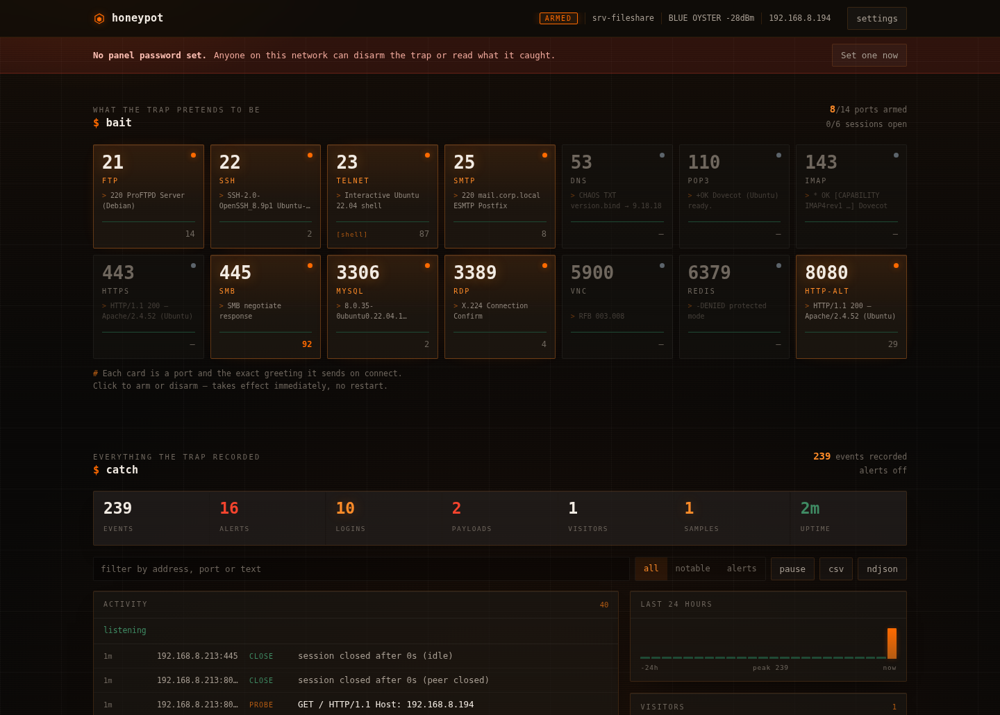
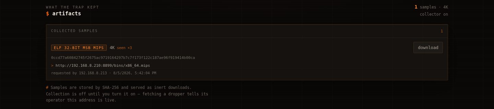

# ESP32 Honeypot

A multi-port honeypot for ESP32 that impersonates a small Linux file server,
records what attackers type, retrieves the malware they try to install, and
shows all of it in a control panel served from the device itself.

**→ [`ESP32-Honeypot-v2/`](ESP32-Honeypot-v2/) is the current version.** Full
documentation, API reference and troubleshooting live in
[its README](ESP32-Honeypot-v2/README.md).

Every screenshot below is the real firmware running on an **ESP32-S3-N16R8**
(16 MB flash, 8 MB octal PSRAM), showing live capture data.



---

## Default credentials

| What | Value |
|---|---|
| Setup network (SSID) | `honeypot-setup` |
| Setup network password | `trapdoor123` |
| Panel URL, setup mode | `http://192.168.4.1/` |
| Panel URL, on your LAN | `http://srv-fileshare.local/` or the DHCP address |
| **Panel password** | **none — unset on first boot, set it during setup** |
| Fake shell login | **any username and password are accepted, by design** |

Change the AP credentials in `ESP32-Honeypot-v2/src/main.cpp` (`AP_SSID` / `AP_PASS`).

## Quick start

```bash
cd ESP32-Honeypot-v2
pio run -e esp32s3 -t upload && pio device monitor
```

Join `honeypot-setup` / `trapdoor123`, open `http://192.168.4.1/`, enter your
Wi-Fi details and **set a panel password**. The device joins your network and
arms the trap; the panel stays reachable while it runs.

Environments: `esp32s3`, `esp32dev`, `atoms3`.

---

## The control panel

**Bait** shows one card per port with the *exact greeting that port sends on
connect* — the thing an attacker actually reads off the wire. Click a card to
arm or disarm it; it takes effect immediately, no reboot.

**Catch** is everything recorded, live — filterable, exportable as NDJSON or CSV.


Colour carries meaning rather than decoration: **green is nominal**, **orange is
live/armed**, **red is an alert** — credential theft, a dropper URL, a path
traversal attempt.

### Artifacts

When something runs `wget`/`curl`/`tftp` in the fake shell, the collector
retrieves the file, hashes it with SHA-256, identifies the target architecture
from its ELF header, deduplicates and stores it for download. The URL dies within
hours; the sample does not.



**Off by default** — fetching a dropper confirms to its operator that your
address is live.

### Settings and mobile

<p>


</p>

---

## Verified against nmap

Real `nmap -sT -sV` against the device, 8 ports armed:

```
21/tcp   open  ftp
22/tcp   open  ssh      OpenSSH 8.9p1 Ubuntu 3ubuntu0.5 (Ubuntu Linux; protocol 2.0)
23/tcp   open  telnet
25/tcp   open  smtp     Postfix smtpd
445/tcp  open  microsoft-ds?
3306/tcp open  mysql    MySQL 8.0.35-0ubuntu0.22.04.1
3389/tcp open  tcpwrapped
8080/tcp open  http     Apache httpd 2.4.52 ((Ubuntu))
```

Only 8 ports can be armed at once. The Arduino core is compiled with
`CONFIG_LWIP_MAX_SOCKETS=16`, so every listener costs a socket an accepted
connection then cannot have — arm 14 and `accept()` starves, which a scanner
reports as `tcpwrapped` on everything. See
[the socket ceiling](ESP32-Honeypot-v2/README.md#the-socket-ceiling).

## Highlights over v1

- Non-blocking connection pool on a dedicated task — v1 ran an infinite loop
  inside `setup()`, and one idle telnet connection froze every port.
- The control panel runs permanently, with token auth and validated writes.
  v1 served the Wi-Fi password in plaintext to unauthenticated clients.
- Mirai-aware telnet: the busybox loader probe is answered byte-accurately, so
  the loader proceeds to the payload stage instead of hanging up.
- Artifact collector, conversational FTP/SMTP/POP3/IMAP/Redis that capture
  credentials, NTP timestamps, rotating NDJSON logs, non-blocking alerts
  (Discord / Telegram / JSON / syslog).

The full list of twelve v1 issues and their fixes is in the
[v2 README](ESP32-Honeypot-v2/README.md#what-changed-from-v1).

---

## Repository layout

```
ESP32-Honeypot-v2/     current version — PlatformIO project
ESP32-C5-Honeypot/     ESP-IDF port for the ESP32-C5
ESP32-Honeypot.ino     v1, generic ESP32
NanoC6-Honeypot.ino    v1, M5Stack NanoC6
AtomS3-Honeypot.ino    v1, M5Stack AtomS3
```

## Credits

Original project by [7h30th3r0n3](https://github.com/7h30th3r0n3/ESP32-Honeypot).
The v1 sketches and the C5 port above are from that work. MIT, as the original.

## Usage

This is a canary for a network you control. Do not expose it to the internet
without upstream filtering — it is a lightweight trap, not Cowrie.
